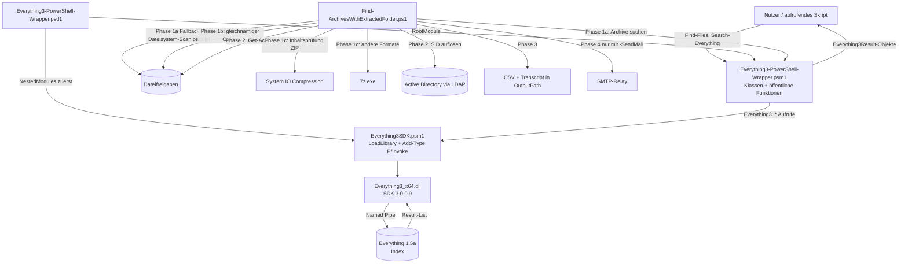

# Architektur-Übersicht – PowerEverything3

---

## Stack

| Schicht | Technologie |
|---------|-------------|
| Öffentliche API | PowerShell-7-Skriptmodul `Everything3-PowerShell-Wrapper` (Manifest `.psd1`, RootModule `.psm1`, PowerShell-Klassen) |
| Interop | `Everything3SDK.psm1`: `LoadLibrary` (kernel32) + `Add-Type` mit C#-P/Invoke-Signaturen auf `Everything3_x64.dll` (SDK 3.0.0.9, nur x64) |
| Suchdienst (extern) | Everything 1.5a (voidtools), lokal; Kommunikation über Named Pipe (SDK3) |
| Beispielanwendung | `Examples/Find-ArchivesWithExtractedFolder.ps1` (PowerShell ≥ 7.2): .NET `System.IO.Compression`, optional `7z.exe`, ADSI/LDAP, SMB-Cmdlets, `Send-MailMessage` |
| Datenbank | keine (der Everything-Index gehört Everything) |
| Auth | keine im Modul (lokale IPC im Benutzerkontext); Beispielskript: Windows-integriert gegen AD, SMTP anonym oder `-SmtpCredential` |
| Build | keiner — Auslieferung ist der Repository-Inhalt (Modulordner inkl. DLL) |

---

## Scope-Grenzen — Was dieses System NICHT tut

Bewusste Negativ-Liste. Sie verhindert Scope Creep und macht
Architekturentscheidungen nachvollziehbar.

- Kein eigener Index und keine Dateisystem-Durchsuchung im Modul — gesucht wird ausschließlich im Index einer laufenden
  Everything-Instanz (der Dateisystem-Scan ist nur ein Fallback des Beispielskripts).
- Keine schreibenden Dateioperationen: weder das Modul noch das Beispielskript löschen, verschieben oder ändern Dateien
  der durchsuchten Bestände (das Beispielskript schreibt nur CSV und Transcript nach `-OutputPath`).
- Keine Unterstützung für Everything 1.4 / SDK 2, Windows PowerShell 5.1, 32-Bit- oder ARM64-Prozesse, Linux/macOS.
- Keine entfernten Everything-Instanzen (ETP/HTTP-Server von Everything) — nur die lokale Instanz über die SDK3-Pipe.
- Kein Mailversand, keine AD-Abfragen im Modul — das gehört ausschließlich zum Beispielskript.
- Keine Zeitplanung (Task Scheduler) im Repository (`docs/KNOWN_ISSUES.md` K4).

Änderungen an dieser Liste sind eine Architekturentscheidung → ADR erforderlich.

---

## Systemstruktur (Datenfluss)



Konfiguration des Beispielskripts (Defaults + optionale `*.config.ps1`): `docs/architecture/CONFIGURATION.md`.

---

## Modul-Verantwortlichkeiten

```
Everything3-PowerShell-Wrapper.psd1  → Manifest: Ladereihenfolge (NestedModule vor RootModule), Exporte
Everything3SDK.psm1                  → native DLL laden und P/Invoke-Typen [Everything3SDK]/[Everything3Properties] bereitstellen
Everything3-PowerShell-Wrapper.psm1  → Verbindung (Everything3Client), Suche, Property-Abruf, Ergebnisobjekte (Everything3Result)
Everything3-Examples.ps1             → Nutzungsbeispiele für Menschen (keine Bibliothek)
Examples/Find-ArchivesWithExtractedFolder.ps1 → Fileserver-Bericht „entpackte Archive" inkl. Besitzer-Mails (Beispielanwendung)
```

---

## Entscheidungsrelevante Constraints

| Constraint | Auswirkung |
|-----------|-----------|
| Everything muss lokal laufen; das SDK spricht nur die Pipe der lokalen Instanz an | Ohne laufendes Everything wirft `Connect-Everything`; Beispielskript fällt bei `-SearchMode Auto` auf den Dateisystem-Scan zurück |
| `Everything3_x64.dll` ist nur x64 und muss neben dem Modul liegen | Kein 32-Bit-/ARM64-Betrieb; Modulordner ist eine Einheit (DLL + psd1 + psm1) |
| PowerShell-7-Syntax (`??`), PowerShell-Klassen referenzieren den `Add-Type`-Typ | Nur PowerShell ≥ 7.0; Import nur über die `.psd1` (`docs/KNOWN_ISSUES.md` K1) |
| SDK-Signaturen müssen exakt zu `Everything3.h` passen (`SIZE_T` = `UIntPtr`, Unicode) | Fehler zeigen sich als falsche/abgeschnittene Werte oder Abstürze, nicht als Exceptions → Integrationstests nötig |
| Beispielskript braucht Administratorrechte (`Get-Acl`, `Get-SmbShare`) und eine Domäne (Besitzer-Auflösung) | Läuft mit hohen Rechten über fremde Dateien → Bedrohungen in `docs/security/THREAT_MODEL.md` |
| Everything indiziert nur konfigurierte Volumes/Ordner | Nicht indizierte Pfade werden gescannt (`Auto`) oder übersprungen (`Everything`) |

---

## Lese-Pfad für Architektur-Details

Wenn du tiefer einsteigen willst, lies in dieser Reihenfolge — jeder Schritt
baut auf dem vorigen auf:

1. **Diese Datei** (`OVERVIEW.md`) — Big Picture, Scope-Grenzen, Datenfluss.
2. `architecture/PROJECT_LAYOUT.md` — wo welche Schicht und welcher Code liegt.
3. `architecture/CONFIGURATION.md` — wie Modul und Beispielskript konfiguriert werden.
4. `architecture/ERROR_HANDLING.md` — wie Fehler propagiert und behandelt werden.
5. `architecture/ADR/` — historische Architekturentscheidungen (bisher nur die Vorlage `ADR-000-template.md`).
6. **Stack-spezifische Architektur-Docs:** `architecture/MODULE.md` (Modulaufbau, Manifest, native DLL, Installation),
   `architecture/DEPENDENCIES.md` (DLL, Everything, 7-Zip, AD, SMTP) und
   `architecture/CREDENTIAL_STRATEGY.md` (SMTP-Credential, Ausführungskonto).
7. Feature-Docs: `features/EVERYTHING_SEARCH.md` (Modul), `features/ARCHIVE_CLEANUP.md` (Beispielskript inkl. Geschäftsregeln).

Begriffe und Geschäftssprache: `docs/GLOSSARY.md`.
Bekannte Einschränkungen und Probleme: `docs/KNOWN_ISSUES.md`.
