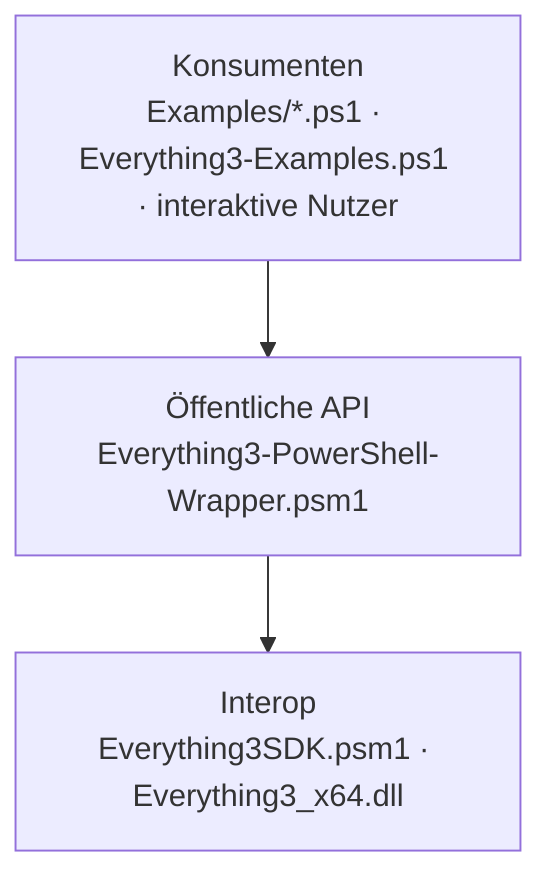

# Projekt-Layout – PowerEverything3

Ordnerstruktur und Schichten-Modell dieses Projekts. Das Template-Skelett (`src/presentation|application|domain|
infrastructure`) ist hier bewusst nicht umgesetzt: Das Projekt ist ein kleines Skriptmodul mit zwei Schichten plus
Beispielen; die Schichten-Trennung zählt, nicht das Ordner-Wording.

Verbindet sich mit den Prinzipien [[SEPARATION_OF_CONCERNS]] und [[ORTHOGONALITY]].

---

## Schichten-Modell



**Regeln für Abhängigkeiten:**

- Pfeile zeigen erlaubte Aufrufrichtung (nur nach unten).
- **Konsumenten** nutzen ausschließlich die exportierten Funktionen (`Connect-Everything`, `Search-Everything`,
  `Disconnect-Everything`, `Find-Files`, `Test-EverythingConnection`) — nie `[Everything3SDK]` direkt.
  Stand Init: eingehalten (beide Beispieldateien rufen nur exportierte Funktionen auf).
- **Öffentliche API** kapselt alle nativen Handles (Client, Search-State, Result-List) und gibt nur PowerShell-Objekte
  (`[Everything3Result]`, `[Everything3Client]`) heraus.
- **Interop** kennt keine Geschäftslogik und keine PowerShell-Klassen der API — nur DLL-Laden und Signaturen.
- **Composition Root** ist das Manifest: Es lädt `Everything3SDK.psm1` als NestedModule vor dem RootModule.

---

## Ist-Struktur

```
PowerEverything3/
├── Everything3-PowerShell-Wrapper.psd1   # Manifest (Composition Root)
├── Everything3-PowerShell-Wrapper.psm1   # öffentliche API
├── Everything3SDK.psm1                   # Interop
├── Everything3_x64.dll                   # native SDK3-DLL (binär, signiert)
├── Everything3-Examples.ps1              # Nutzungsbeispiele
├── Examples/
│   ├── Find-ArchivesWithExtractedFolder.ps1
│   └── Find-ArchivesWithExtractedFolder.config.example.ps1   # echte *.config.ps1, *.csv, *.log: gitignored
├── skills/everything-search/SKILL.md     # Skill für KI-Agenten (englisch, öffentlich, ohne Interna)
├── tests/Integration/                    # Pester-Integrationstests gegen lokales Everything (Tag Integration)
├── tools/git-hooks/                      # Interna-Hook (pre-commit, commit-msg)
├── docs/                                 # dieses Doku-Set (docs/local/ gitignored)
├── README.md, README-DE.md, LICENSE
└── AGENTS.md, CLAUDE.md                  # Agenten-Einstieg → docs/KICKOFF.md
```

Geplant (I2/I5/I6): `tests/` mit `RequiredModules.psd1`, Unit-Tests (`*.Tests.ps1`) und `tests/Integration/`
(Pester-Tag `Integration`).

---

## Regeln

- **Eine Datei pro Schicht** solange das Modul klein bleibt; wächst die API, Aufteilung nach `Public/`/`Private/`
  mit explizitem `FunctionsToExport` (`docs/CONVENTIONS.md` §3).
- **Beispiele sind Konsumenten, keine Bibliothek:** Wiederverwendbare Logik aus `Examples/` wandert erst in ein Modul,
  wenn ein zweiter Konsument sie braucht.
- **Imports gehen nur nach unten** — die Interop-Schicht importiert nichts aus der API.
- **Tests parallel zur Quellstruktur.** Eine Test-Datei pro Modul bzw. Skript.
- **Ausgaben und echte Konfiguration** (`*.csv`, `*.log`, `*.config.ps1`) gehören in `.gitignore`.

---

## Schichtregel als ausführbarer Check

Noch nicht umgesetzt (es gibt noch keine Tests). Vorgesehen ist ein Pester-Test über den AST
(`docs/BACKLOG.md` → Ideen): Dateien unter `Examples/` und `Everything3-Examples.ps1` dürfen keinen Typ-Literal
`[Everything3SDK]`/`[Everything3Properties]` enthalten; `Everything3SDK.psm1` darf keine Funktion des RootModule
aufrufen. Der Check bekommt eine erlaubte und eine verbotene Beispielkante als eigene Tests und läuft in Gate 4 mit.

---

## Anti-Pattern

- **Konsument ruft die DLL direkt:** umgeht Handle-Freigabe und Fehlerbehandlung der API.
- **Interop-Schicht mit Seiteneffekten außerhalb des Moduls** (z. B. `$env:PATH` dauerhaft ändern — heute der Fall,
  `docs/KNOWN_ISSUES.md` K2).
- **„Utils"-Sammelbecken** im Beispielskript statt klarer Phasen-Funktionen.

---

## Pflege

Trigger (siehe `KICKOFF.md` Phase 3a): neue Schicht / Modul-Verschiebung
zwischen Schichten / neue stack-spezifische Layout-Variante → diese Datei
aktualisieren.
